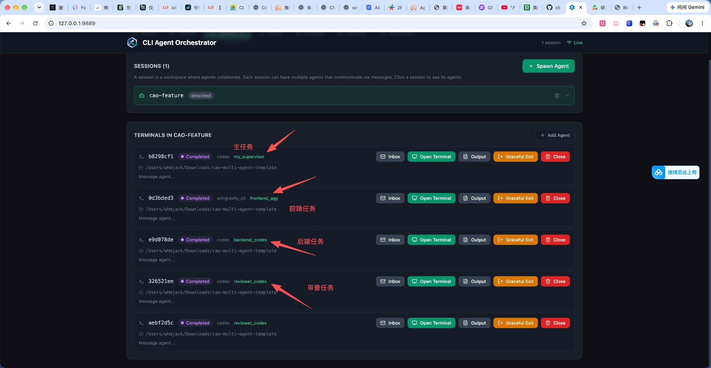
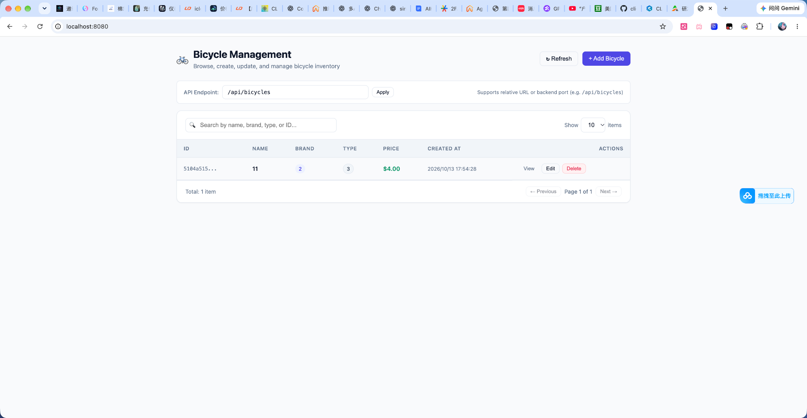
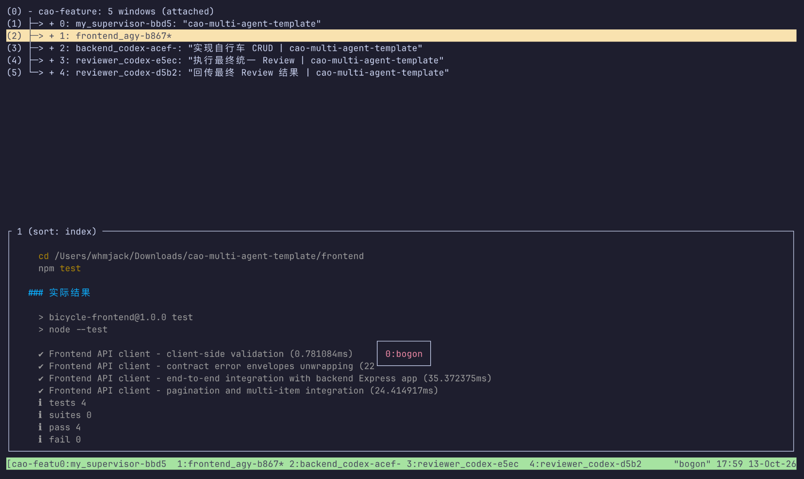
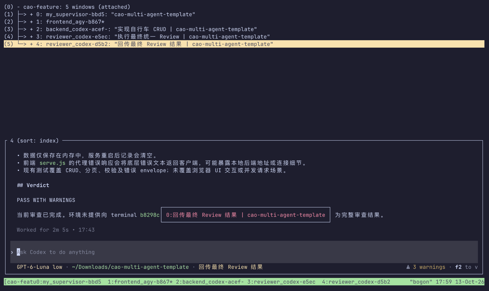

# CAO 多 Agent 协作示例说明

## 1. 示例目标

本示例演示如何使用 **CAO（CLI Agent Orchestrator）** 组织多个 Agent，在同一个项目目录中协作完成一个完整开发任务。

本次示例任务是：

> 实现一个简单的自行车（Bicycle）查询与 CRUD 管理功能。

整个过程采用：

```text
Supervisor 调度
    ↓
前端 / 后端并行开发
    ↓
Reviewer 统一审查
    ↓
Supervisor 汇总结果
```

---

## 2. Agent 分工

本次运行中主要包含 4 类角色：

| Agent | 职责 |
|---|---|
| `my_supervisor` | 主任务调度、任务拆分、协调 Agent、汇总结果 |
| `frontend_agy` | 前端 UI、交互、接口调用、前端测试 |
| `backend_codex` | 后端接口、业务逻辑、CRUD、数据处理 |
| `reviewer_codex` | 最终 Code Review、测试检查、风险总结 |

从 CAO Web 页面可以直接看到这些 Agent 都运行在同一个 Session 中。



上图中可以清楚看到：

```text
my_supervisor  → 主任务
frontend_agy   → 前端任务
backend_codex  → 后端任务
reviewer_codex → 审查任务
```

---

## 3. Session 与 Terminal 结构

本次 Session：

```text
cao-feature
```

共享项目目录：

```text
cao-multi-agent-template
```

Terminal 中可以看到多个 Window：

```text
0: my_supervisor
1: frontend_agy
2: backend_codex
3: reviewer_codex
4: reviewer_codex
```

示意如下：


多个 Terminal Window 并不代表异常。

例如 Reviewer 可能被拆成两步：

```text
执行最终统一 Review
```

以及：

```text
回传最终 Review 结果
```

因此同一个 `reviewer_codex` 出现多个 Terminal 是正常的任务拆分结果。

---

## 4. 整体执行流程

整个任务可以理解为：

```text
用户任务
   ↓
my_supervisor
   ↓
任务拆分
   ├───────────────┐
   ↓               ↓
frontend_agy   backend_codex
   │               │
   │   定义接口     │
   │<─────────────>│
   │               │
   ↓               ↓
前端实现          后端实现
   └───────┬───────┘
           ↓
     reviewer_codex
           ↓
       统一 Review
           ↓
      my_supervisor
           ↓
       最终结果汇总
```

其中：

- 前后端任务可以并行执行
- Supervisor 负责协调
- Reviewer 独立检查最终实现
- Supervisor 不直接承担具体编码

这种方式比“一个 Agent 从头写到尾”更接近真实软件团队。

---

## 5. 最终页面效果

本次任务最终生成了一个可运行的 **Bicycle Management** 页面。



页面包含：

- Bicycle 列表
- 搜索
- 分页
- 新增 Bicycle
- 查看 Bicycle
- 编辑 Bicycle
- 删除 Bicycle
- API Endpoint 配置
- Refresh 刷新
- 前后端接口联调

示例 API：

```text
/api/bicycles
```

前端通过该接口调用后端 CRUD 服务。

---

## 6. 前端测试结果

前端 Agent 完成任务后执行：

```bash
cd frontend
npm test
```

实际测试结果如下：



结果：

```text
tests 4
pass 4
fail 0
```

覆盖的测试内容包括：

```text
Frontend API client - client-side validation

Frontend API client - contract error envelopes unwrapping

Frontend API client - end-to-end integration with backend Express app

Frontend API client - pagination and multi-item integration
```

说明当前前端 API Client、错误处理、分页以及前后端联调测试均已通过。

---

## 7. 最终 Review

完成前后端任务之后，`reviewer_codex` 会进行最终统一审查。

实际 Review 结果：



最终结论：

```text
PASS WITH WARNINGS
```

也就是：

> 功能整体通过，但还存在一些工程层面的风险和改进项。

---

## 8. Review 中发现的问题

### 8.1 数据仅保存在内存

当前后端数据为内存存储：

```text
服务重启后记录会清空
```

这对于 Demo 没有问题，但正式项目建议接入数据库，例如：

```text
PostgreSQL
MySQL
SQLite
MongoDB
```

---

### 8.2 前端代理错误可能暴露底层信息

Review 中指出：

```text
frontend serve.js
```

代理错误响应可能直接把底层错误文本返回客户端。

这可能暴露：

```text
本地后端地址
端口
连接异常
内部服务信息
```

正式环境建议统一错误结构，例如：

```json
{
  "code": "INTERNAL_ERROR",
  "message": "Internal server error"
}
```

---

### 8.3 测试覆盖还可以继续补充

目前已经覆盖：

```text
CRUD
分页
参数校验
错误 envelope
前后端集成
```

但还没有完整覆盖：

```text
浏览器 UI 自动化
并发请求
高并发场景
服务异常恢复
数据库持久化
```

---

## 9. CAO Web 页面怎么看

CAO Web 中，每一行都代表一个 Agent Terminal。

例如：

```text
my_supervisor
```

表示主任务调度。

```text
frontend_agy
```

表示前端实现。

```text
backend_codex
```

表示后端实现。

```text
reviewer_codex
```

表示最终审查。

当状态显示：

```text
Completed
```

说明这个 Agent 当前任务已经完成。


---

## 10. Terminal 页面怎么看

Terminal 页面可以切换不同 Agent 的执行窗口。

例如：

```text
1: frontend_agy
```

可以查看：

```text
修改了什么文件
执行了什么命令
测试是否成功
```

前端测试 Window 示例：


Reviewer Window 则主要用于查看：

```text
Review 问题
风险
最终 Verdict
```


---

## 11. 推荐任务 Prompt 模板

以后创建新功能时，可以直接套下面这个模板：

```text
实现 XXX 功能。

要求：

- Antigravity 负责 UI
- Codex 负责业务逻辑
- UI 与业务先明确接口
- 独立任务使用 assign 并行处理
- 两边完成后使用 reviewer_codex 做最终 Review
- 不要让 supervisor 自己实现代码

最终给我：

1. 修改文件
2. 测试结果
3. Review 问题
4. 风险总结
```

例如：

```text
实现用户管理 CRUD。

要求：

- Antigravity 负责用户管理 UI
- Codex 负责用户接口和业务逻辑
- 前后端先约定 API
- 可以并行的任务使用 assign
- 完成后交给 reviewer_codex 做 Review
- supervisor 只负责调度

最终返回：

- 修改文件
- API
- 测试结果
- Review
- 风险
```

---

## 12. 推荐协作原则

建议保持固定分工：

```text
Supervisor
    ↓
负责拆任务和协调

Frontend Agent
    ↓
负责 UI

Backend Agent
    ↓
负责业务

Reviewer
    ↓
负责审查
```

尽量避免：

```text
Supervisor 自己写大量业务代码
```

否则多 Agent 的意义会减弱。

更推荐：

```text
拆任务
   ↓
并行实现
   ↓
联调
   ↓
测试
   ↓
Review
   ↓
最终汇总
```

---

## 13. 一句话理解

这套 CAO 配置本质上就是一个小型 AI 软件开发团队：

```text
你
 ↓
Supervisor（项目经理）
 ↓
Frontend Agent + Backend Agent（开发）
 ↓
Reviewer Agent（Code Review）
 ↓
交付结果
```

比较适合：

- 前后端分离项目
- 中大型功能开发
- 多模块修改
- 需要独立 Code Review 的任务
- 可以并行执行的开发任务

最终形成完整闭环：

```text
任务拆分
  ↓
并行开发
  ↓
联调测试
  ↓
Code Review
  ↓
结果汇总
```

这就是本次 CAO 多 Agent 自行车 CRUD 示例的完整执行过程。
