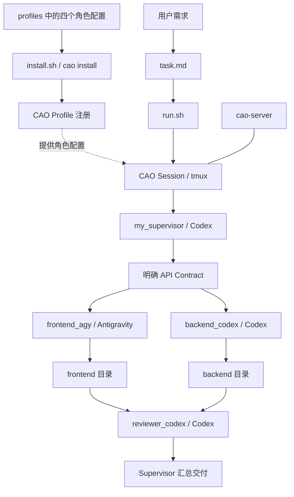
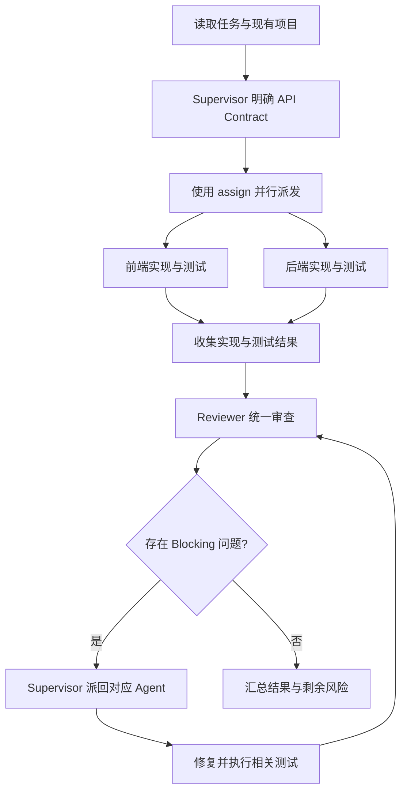
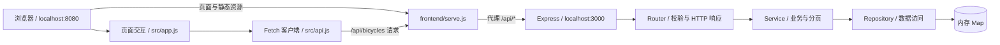

# CAO 多 Agent 协作模板

基于 CAO（CLI Agent Orchestrator）的多 Agent 开发模板，将需求协调、前端开发、后端开发和最终审查交给固定角色，形成可复用的协作流程。

仓库包含四个 Agent Profile、安装与启动脚本、任务模板，以及一个已实现的自行车 CRUD 示例。可以直接运行示例，也可以将这套协作配置用于已有的前后端项目。

## 架构与角色

| Agent | Provider | 职责 | 工作边界 |
| --- | --- | --- | --- |
| `my_supervisor` | `codex` | 理解需求、明确接口、分派任务、协调冲突、汇总交付 | 只协调，不实现业务代码 |
| `frontend_agy` | `antigravity_cli` | 页面、交互、状态管理、API 接入、前端测试 | 在前端目录工作，遵守前端工程规范 |
| `backend_codex` | `codex` | API、业务逻辑、数据访问、参数校验、后端测试 | 在后端目录工作，遵守后端工程规范 |
| `reviewer_codex` | `codex` | 统一检查需求、接口一致性、实现、测试与风险 | 输出审查结论，不做大规模重写 |



`run.sh` 只启动 Supervisor 并发送任务；前端、后端和 Reviewer 由 Supervisor 按 Profile 中的流程使用 `assign` 分派。Supervisor 的 Profile 配置了 `cao-mcp-server`，用于协作调度。

各 Worker 需要先阅读所在项目的 `AGENTS.md`、README 和已有工程规范，并优先使用项目自带的 skills、MCP 和组件体系。多个 Agent 在同一项目下按目录分工，模板没有自动创建独立分支或 worktree。

## 协作流程

开发前先明确最小 API Contract：URL、Method、Request、Response、字段类型、错误结构，以及需要时的分页格式。前后端基于同一份约定并行实现；需要调整接口时，先交给 Supervisor 协调。



Reviewer 固定输出 `Blocking`、`Non-blocking`、`Tests`、`Risks` 和 `Verdict`，结论为 `PASS`、`PASS WITH WARNINGS` 或 `FAIL`。Blocking 问题修复后再次审查，Non-blocking 建议记录在交付结果中，避免无限返工。

最终交付应包含修改文件、前端结果、后端结果、测试结果、Review 结果、Blocking 问题和已知风险。

## 仓库结构

```text
cao-multi-agent-template/
├── profiles/                     # CAO Agent Profile
│   ├── my_supervisor.md          # 任务协调与接口约定
│   ├── frontend_agy.md           # Antigravity 前端开发
│   ├── backend_codex.md          # Codex 后端开发
│   └── reviewer_codex.md         # Codex 最终审查
├── install.sh                    # 安装四个 Profile
├── run.sh                        # 创建 Session 并发送任务
├── terminal.sh                   # 向 cao-feature 补发执行指令
├── task.md                       # 可编辑任务模板，当前为自行车 CRUD
├── frontend/                     # HTML / CSS / JavaScript 示例
│   ├── AGENTS.md                 # 前端工作规范与接口约定
│   ├── serve.js                  # 静态服务与 API 代理
│   ├── src/                      # 页面逻辑与 Fetch 客户端
│   └── test/                     # 前端 API 与集成测试
├── backend/                      # Node.js / Express 示例
│   ├── AGENTS.md                 # 后端工作规范与接口约定
│   ├── src/bicycles/             # Router / Service / Repository
│   ├── test/                     # 后端接口测试
│   └── package-lock.json         # 后端依赖锁文件
├── CAO多Agent协作示例/             # 协作过程说明、截图与 PDF
├── .gitignore                    # 依赖、产物及本地文件忽略规则
└── README.md
```

## 环境准备

- Bash 与 tmux。
- 已安装并可运行的 CAO，提供 `cao`、`cao-server`、`cao-mcp-server` 命令。
- 已安装并完成所需登录或配置的 Codex CLI 与 Antigravity CLI，CAO 可使用 `codex` 和 `antigravity_cli` Provider。
- 运行自行车示例时，建议使用 Node.js 22 或更高版本及 npm。

CAO 和 Provider CLI 的安装、认证按各工具的文档完成；本仓库的 `install.sh` 只安装 Agent Profile。

## 第一次使用

在模板根目录执行：

```bash
chmod +x install.sh run.sh
./install.sh
```

检查安装结果：

```bash
cao profile list
```

应能看到 `my_supervisor`、`frontend_agy`、`backend_codex`、`reviewer_codex`。Profile 通过 `cao install` 注册，无需手动复制到 CAO 配置目录。

## 每次开发

### 1. 编辑任务

修改 [task.md](task.md) 中的功能需求和前后端目录，例如：

```text
实现：用户管理 CRUD

前端：frontend
后端：backend
```

同时补充业务规则、验收标准和接口约束。当前前后端目录中的 `AGENTS.md` 包含自行车示例约定，更换业务时应同步检查并更新这些约定。

### 2. 启动 CAO 服务

在第一个终端运行：

```bash
cao-server
```

### 3. 启动协作 Session

在第二个终端进入实际项目根目录。模板就在项目根目录时：

```bash
./run.sh feature task.md
```

模板与实际项目分开存放时，在实际项目根目录执行：

```bash
/path/to/cao-multi-agent-template/run.sh feature /path/to/cao-multi-agent-template/task.md
```

`run.sh` 使用当前终端目录（`$PWD`）作为项目工作目录，并开启 `CAO_ENABLE_WORKING_DIRECTORY=true`，便于 Supervisor 为 Worker 指定前后端目录。脚本当前使用 `cao launch --auto-approve`，运行前应确认符合自己的本地权限设置。

首个参数是 Session 名称，第二个参数是任务文件；默认值分别为 `feature` 和 `task.md`。上述示例生成的 Session 为 `cao-feature`。

### 4. 查看状态与停止

```bash
# 查看 Supervisor 与 Worker 状态
cao session status cao-feature --workers

# 进入 tmux 查看各 Agent 的终端
tmux attach -t cao-feature

# 停止 Session
cao shutdown --session cao-feature
```

使用自定义 Session 名称时，将上述 `cao-feature` 替换为对应的 `cao-<名称>`。

`terminal.sh` 可向 `cao-feature` 补发“立即执行任务”的指令，适用于任务已送达但需要再次推动执行的情况；它不会创建 Session，且内部 Session 名称目前固定。

## 自行车 CRUD 示例

示例前端使用 HTML、CSS、JavaScript ES Modules 和 Fetch；后端使用 Express 5，并按 Router、Service、Repository 分层。



响应经相同调用链返回，前端 API 客户端解析统一响应结构并更新页面。Repository 当前使用进程内存，后端重启后数据清空。

### 启动示例

第一个终端，在仓库根目录执行：

```bash
cd backend
npm ci
npm start
```

第二个终端，在仓库根目录执行：

```bash
cd frontend
npm start
```

打开 `http://localhost:8080`。前端默认将 `/api/*` 代理到 `http://localhost:3000`；后端端口由 `PORT` 控制，前端端口由其进程的 `PORT` 控制，代理目标端口由 `BACKEND_PORT` 控制。前端自身没有第三方运行依赖。

### 接口约定

| Method | URL | 用途 |
| --- | --- | --- |
| `GET` | `/api/bicycles?page=1&pageSize=10` | 分页查询 |
| `GET` | `/api/bicycles/:id` | 获取详情 |
| `POST` | `/api/bicycles` | 新增 |
| `PUT` | `/api/bicycles/:id` | 全量更新业务字段 |
| `DELETE` | `/api/bicycles/:id` | 删除 |

新增和更新请求必须且只能包含 `name`、`brand`、`type`、`price`；前三项为非空字符串，`price` 为大于等于 0 的有限数值。后端生成 `id` 和 `createdAt`。分页参数为正整数，`pageSize` 最大为 100。

成功响应为 `{ success: true, data, error: null }`，列表额外返回 `meta: { page, pageSize, total }`；失败响应为 `{ success: false, data: null, error: { code, message } }`。

### 测试命令

前后端均使用 Node.js 内置测试运行器。先安装后端依赖，再从仓库根目录执行：

```bash
# 后端测试（从仓库根目录运行）
npm --prefix backend test

# 前端 API 与后端集成测试（从仓库根目录运行）
npm --prefix frontend test
```

示例的运行截图、历史测试结果与 Review 记录见 [CAO 多 Agent 协作示例说明](CAO多Agent协作示例/README.md)，前端细节见 [前端 README](frontend/README.md)。历史记录不代表当前环境已重新执行验证。

## 作为模板仓库复用

1. 保留 `profiles/`、`install.sh`、`run.sh` 和任务模板作为协作入口。
2. 将任务中的目录改为目标项目的实际路径，并让 Worker 使用该项目已有规范和基础设施。
3. 根据业务调整任务与 API Contract，再由前后端并行实现。
4. 保留独立 Review 与 Blocking 修复闭环，在交付中记录测试证据和剩余风险。

`.gitignore` 已覆盖任意层级的 `node_modules/`、构建输出、覆盖率、缓存、日志、`.env` 本地配置和系统临时文件。`.env.example` 等环境模板、依赖锁文件、Agent Profile、工程规范和示例截图/PDF 应随仓库保留。

提交前可用 `git status --short` 查看待提交文件，用 `git check-ignore -v <文件路径>` 定位忽略规则。已经被 Git 跟踪的文件不会因新增忽略规则而自动取消跟踪。
